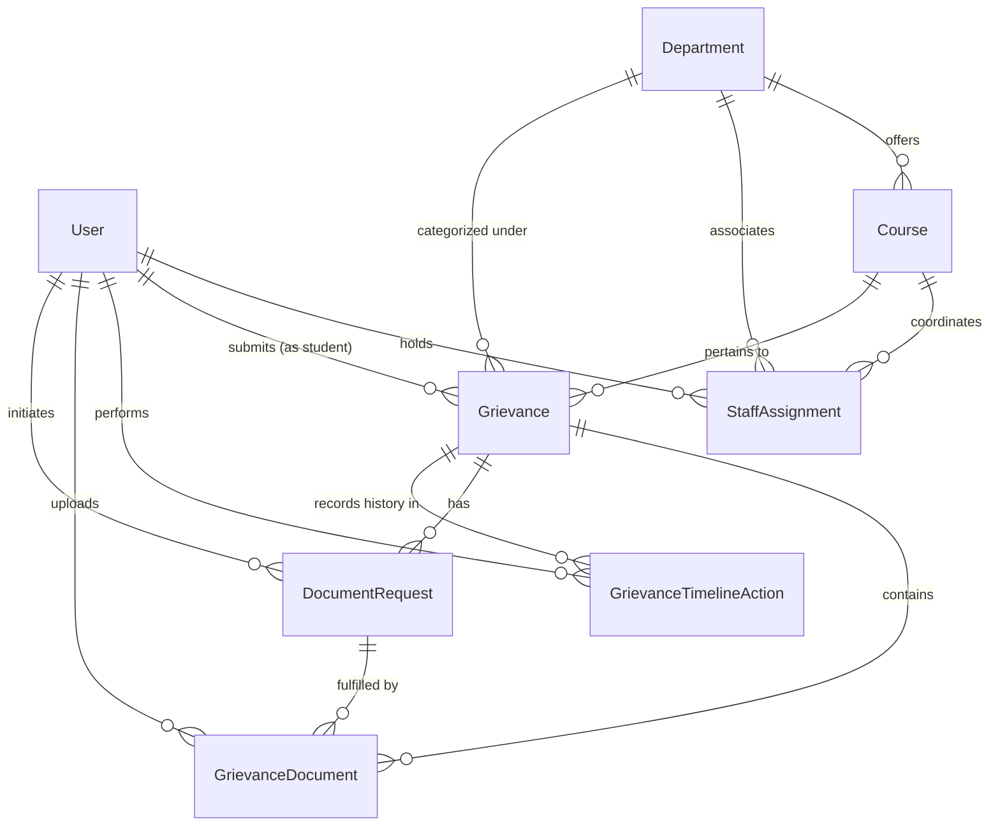

# SAMVAD Data Model & Database Specification
**Neon PostgreSQL & Prisma ORM**

---

## 1. Entity-Relationship Diagram (ERD)



---

## 2. Prisma Schema Definition (`prisma/schema.prisma`)

```prisma
datasource db {
  provider  = "postgresql"
  url       = env("DATABASE_URL")
  directUrl = env("DIRECT_URL")
}

generator client {
  provider = "prisma-client-js"
}

// -------------------------------------------------------------
// ENUMS
// -------------------------------------------------------------

enum UserRole {
  STUDENT
  COURSE_COORDINATOR
  HOD
  DIRECTOR
  ADMIN
}

enum GrievanceTier {
  TIER_1_COORDINATOR
  TIER_2_HOD
  TIER_3_DIRECTOR
}

enum GrievanceStatus {
  SUBMITTED
  UNDER_REVIEW
  AWAITING_STUDENT_INFO
  FORWARDED
  RESOLVED
  DISMISSED
}

enum GrievanceCategory {
  ACADEMIC
  EXAMINATION
  LABORATORY
  ADMINISTRATIVE
  FACULTY_MENTORSHIP
  OTHER
}

enum DocumentRequestStatus {
  PENDING
  FULFILLED
  CANCELLED
}

enum TimelineActionType {
  SUBMITTED
  ASSIGNED
  UNDER_REVIEW_MARKED
  DOCUMENTS_REQUESTED
  DOCUMENTS_SUBMITTED
  INTERNAL_REMARK_ADDED
  FORWARDED
  RESOLVED
  DISMISSED
}

enum TimelineVisibility {
  PUBLIC_TO_STUDENT
  INTERNAL_STAFF_ONLY
}

enum DocumentPurpose {
  INITIAL_SUPPORT
  REQUESTED_SUPPLEMENT
  RESOLUTION_PROOF
}

// -------------------------------------------------------------
// USER & AUTHENTICATION
// -------------------------------------------------------------

model User {
  id              String         @id @default(uuid())
  email           String         @unique
  passwordHash    String
  fullName        String
  role            UserRole       @default(STUDENT)
  phoneNumber     String?
  rollNumber      String?        @unique // Applicable for Students
  enrollmentNo    String?        @unique // Applicable for Students
  isActive        Boolean        @default(true)
  mustResetPassword Boolean      @default(false)
  createdAt       DateTime       @default(now())
  updatedAt       DateTime       @updatedAt

  // Relations
  studentGrievances       Grievance[]             @relation("StudentGrievances")
  assignedGrievances      Grievance[]             @relation("AssignedOfficial")
  staffAssignments        StaffAssignment[]
  timelineActions         GrievanceTimelineAction[]
  uploadedDocuments       GrievanceDocument[]
  requestedDocuments      DocumentRequest[]       @relation("RequestedByStaff")
  sessions                Session[]
  adminAuditLogs          SystemAuditLog[]

  @@index([role, isActive])
  @@index([email])
  @@index([rollNumber])
}

model Session {
  id        String   @id @default(uuid())
  userId    String
  token     String   @unique
  expiresAt DateTime
  createdAt DateTime @default(now())

  user User @relation(fields: [userId], references: [id], onDelete: Cascade)

  @@index([userId])
}

// -------------------------------------------------------------
// ACADEMIC MASTER DATA
// -------------------------------------------------------------

model Department {
  id          String   @id @default(uuid())
  name        String   @unique // e.g., "Department of Mathematics"
  code        String   @unique // e.g., "MATH"
  description String?
  isActive    Boolean  @default(true)
  createdAt   DateTime @default(now())
  updatedAt   DateTime @updatedAt

  // Relations
  courses          Course[]
  staffAssignments StaffAssignment[]
  grievances       Grievance[]

  @@index([isActive])
}

model Course {
  id           String     @id @default(uuid())
  departmentId String
  name         String     // e.g., "M.Sc. Mathematics"
  code         String     // e.g., "MSCMATH"
  programType  String?    // "Undergraduate", "Postgraduate", "PhD"
  isActive     Boolean    @default(true)
  createdAt    DateTime   @default(now())
  updatedAt    DateTime   @updatedAt

  department       Department        @relation(fields: [departmentId], references: [id], onDelete: Restrict)
  staffAssignments StaffAssignment[]
  grievances       Grievance[]

  @@unique([departmentId, code])
  @@index([departmentId, isActive])
}

model StaffAssignment {
  id           String     @id @default(uuid())
  userId       String
  role         UserRole   // COURSE_COORDINATOR or HOD
  departmentId String
  courseId     String?    // Specific course for Coordinator; null for HoD
  isActive     Boolean    @default(true)
  assignedAt   DateTime   @default(now())
  unassignedAt DateTime?

  user       User       @relation(fields: [userId], references: [id], onDelete: Restrict)
  department Department @relation(fields: [departmentId], references: [id], onDelete: Restrict)
  course     Course?    @relation(fields: [courseId], references: [id], onDelete: Restrict)

  @@index([userId, isActive])
  @@index([departmentId, courseId, isActive])
}

// -------------------------------------------------------------
// GRIEVANCE CORE
// -------------------------------------------------------------

model Grievance {
  id               String            @id @default(uuid())
  trackingNumber   String            @unique // e.g. "CSJMU-SBS-2026-MATH-0142"
  studentId        String
  departmentId     String
  courseId         String
  assignedToUserId String?           // Currently assigned handling official
  
  category         GrievanceCategory
  subject          String            @db.VarChar(150)
  description      String            @db.Text
  reliefSought     String?           @db.VarChar(500)
  
  currentTier      GrievanceTier     @default(TIER_1_COORDINATOR)
  currentStatus    GrievanceStatus   @default(SUBMITTED)
  
  resolvedAt       DateTime?
  resolutionSummary String?          @db.Text
  
  createdAt        DateTime          @default(now())
  updatedAt        DateTime          @updatedAt

  // Relations
  student          User                      @relation("StudentGrievances", fields: [studentId], references: [id], onDelete: Restrict)
  assignedTo       User?                     @relation("AssignedOfficial", fields: [assignedToUserId], references: [id], onDelete: SetNull)
  department       Department                @relation(fields: [departmentId], references: [id], onDelete: Restrict)
  course           Course                    @relation(fields: [courseId], references: [id], onDelete: Restrict)
  
  documents        GrievanceDocument[]
  documentRequests DocumentRequest[]
  timelineActions  GrievanceTimelineAction[]

  @@index([trackingNumber])
  @@index([studentId, currentStatus])
  @@index([departmentId, currentTier, currentStatus])
  @@index([courseId, currentTier, currentStatus])
  @@index([createdAt])
}

// -------------------------------------------------------------
// DOCUMENTS & EVIDENCE
// -------------------------------------------------------------

model GrievanceDocument {
  id                String          @id @default(uuid())
  grievanceId       String
  uploadedById      String
  requestId         String?         // Set if uploaded in response to a DocumentRequest
  
  fileName          String          // Original sanitized filename
  storageKey        String          @unique // UUID-based object storage path
  fileSize          Int             // In bytes (max 5242880 = 5MB)
  mimeType          String          // Verified MIME type (application/pdf, image/jpeg, etc.)
  sha256Hash        String?         // Integrity verification hash
  purpose           DocumentPurpose @default(INITIAL_SUPPORT)
  
  createdAt         DateTime        @default(now())

  grievance       Grievance        @relation(fields: [grievanceId], references: [id], onDelete: Restrict)
  uploadedBy      User             @relation(fields: [uploadedById], references: [id], onDelete: Restrict)
  documentRequest DocumentRequest? @relation(fields: [requestId], references: [id], onDelete: SetNull)

  @@index([grievanceId])
  @@index([uploadedById])
}

model DocumentRequest {
  id                  String                @id @default(uuid())
  grievanceId         String
  requestedById       String
  requestedTier       GrievanceTier
  
  instructions        String                @db.Text // Clear instructions on what proof is required
  deadline            DateTime?
  status              DocumentRequestStatus @default(PENDING)
  
  fulfilledAt         DateTime?
  createdAt           DateTime              @default(now())
  updatedAt           DateTime              @updatedAt

  grievance   Grievance           @relation(fields: [grievanceId], references: [id], onDelete: Restrict)
  requestedBy User                @relation("RequestedByStaff", fields: [requestedById], references: [id], onDelete: Restrict)
  documents   GrievanceDocument[]

  @@index([grievanceId, status])
}

// -------------------------------------------------------------
// AUDIT LOGGING & TIMELINE (IMMUTABLE)
// -------------------------------------------------------------

model GrievanceTimelineAction {
  id           String             @id @default(uuid())
  grievanceId  String
  actorId      String
  actorRole    UserRole
  
  actionType   TimelineActionType
  fromTier     GrievanceTier?
  toTier       GrievanceTier?
  fromStatus   GrievanceStatus?
  toStatus     GrievanceStatus?
  
  remarks      String?            @db.Text
  visibility   TimelineVisibility @default(PUBLIC_TO_STUDENT)
  ipAddress    String?
  userAgent    String?
  
  createdAt    DateTime           @default(now())

  grievance Grievance @relation(fields: [grievanceId], references: [id], onDelete: Restrict)
  actor     User      @relation(fields: [actorId], references: [id], onDelete: Restrict)

  @@index([grievanceId, visibility, createdAt])
  @@index([actorId])
}

model SystemAuditLog {
  id          String   @id @default(uuid())
  adminUserId String
  action      String   // e.g. "USER_CREATED", "STAFF_ASSIGNED", "PASSWORD_RESET"
  targetModel String   // e.g. "User", "Department", "Course"
  targetId    String
  details     Json?    // Structured payload of previous/new state
  ipAddress   String?
  createdAt   DateTime @default(now())

  adminUser User @relation(fields: [adminUserId], references: [id], onDelete: Restrict)

  @@index([adminUserId])
  @@index([targetModel, targetId])
  @@index([createdAt])
}
```

---

## 3. Data Integrity & Constraints

1. **Deletion Policies**:
   - Master data (Departments, Courses, Staff, Complaints) have `onDelete: Restrict`. Historical records cannot be accidentally or maliciously deleted if associated with grievances or timeline entries.
2. **Deterministic Tracking Numbers**:
   - Tracking numbers are enforced unique in PostgreSQL via unique index (`CSJMU-SBS-YYYY-[DEPT]-[SEQ]`).
3. **Atomic State Updates**:
   - All state transitions create an entry in `GrievanceTimelineAction` in the same database transaction (`$transaction`).
4. **Optimistic Concurrency**:
   - The `updatedAt` field on `Grievance` prevents concurrent modifications from conflicting staff reviews.
