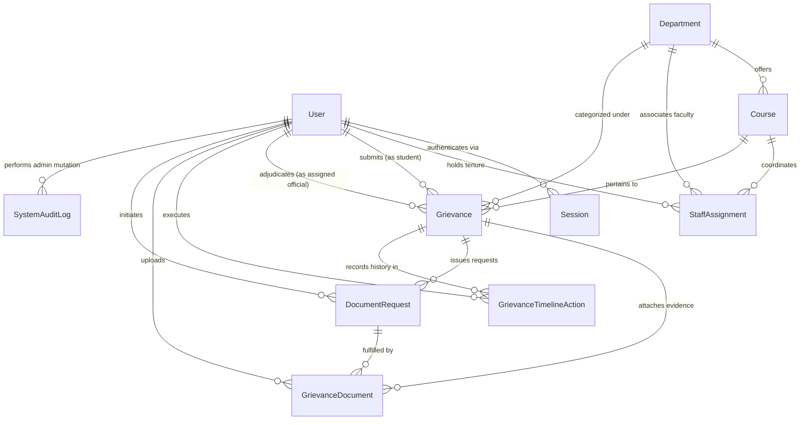

# SAMVAD Data Model & Database Specification
**Neon PostgreSQL & Prisma ORM**  
*Document Version: 2.0 (Master Production Specification)*  

---

## 1. Entity-Relationship Diagram (ERD)



---

## 2. Enums Specification

All enums are defined as native PostgreSQL custom types via Prisma:

```prisma
enum UserRole {
  STUDENT
  COURSE_COORDINATOR
  DEPARTMENT_HEAD
  DIRECTOR
  SYSTEM_ADMIN
}

enum GrievanceTier {
  TIER_1_COORDINATOR
  TIER_2_HOD
  TIER_3_DIRECTOR
}

enum GrievanceStatus {
  SUBMITTED
  UNDER_REVIEW
  AWAITING_STUDENT_INFO
  FORWARDED
  RESOLVED
  DISMISSED
}

enum GrievanceCategory {
  ACADEMIC
  EXAMINATION
  LABORATORY
  ADMINISTRATIVE
  FACULTY_MENTORSHIP
  OTHER
}

enum DocumentRequestStatus {
  PENDING
  FULFILLED
  CANCELLED
}

enum TimelineActionType {
  SUBMITTED
  ASSIGNED
  UNDER_REVIEW_MARKED
  DOCUMENTS_REQUESTED
  DOCUMENTS_SUBMITTED
  INTERNAL_REMARK_ADDED
  FORWARDED
  RESOLVED
  DISMISSED
}

enum TimelineVisibility {
  PUBLIC_TO_STUDENT
  INTERNAL_STAFF_ONLY
}

enum DocumentPurpose {
  INITIAL_SUPPORT
  REQUESTED_SUPPLEMENT
  RESOLUTION_PROOF
}
```

---

## 3. Relational Models Specification

### 3.1 User & Authentication

#### Model: `User`
Stores all portal identities. Role privileges are strictly bounded by `role`.
```prisma
model User {
  id                String    @id @default(uuid())
  email             String    @unique
  passwordHash      String
  fullName          String
  role              UserRole  @default(STUDENT)
  phoneNumber       String?
  rollNumber        String?   @unique // Unique roll number for Students
  enrollmentNo      String?   @unique // Unique enrollment number for Students
  isActive          Boolean   @default(true) // Account status
  mustResetPassword Boolean   @default(false) // Forced reset on initial staff login
  createdAt         DateTime  @default(now())
  updatedAt         DateTime  @updatedAt

  // Relationships
  studentGrievances  Grievance[]               @relation("StudentGrievances")
  assignedGrievances Grievance[]               @relation("AssignedOfficial")
  staffAssignments   StaffAssignment[]
  timelineActions    GrievanceTimelineAction[]
  uploadedDocuments  GrievanceDocument[]
  requestedDocuments DocumentRequest[]         @relation("RequestedByStaff")
  sessions           Session[]
  adminAuditLogs     SystemAuditLog[]

  @@index([role, isActive])
  @@index([email])
  @@index([rollNumber])
}
```

#### Model: `Session`
Stores active session tokens hashed with SHA-256 at rest.
```prisma
model Session {
  id        String   @id @default(uuid())
  userId    String
  token     String   @unique // SHA-256 digest of 256-bit random hex
  expiresAt DateTime
  createdAt DateTime @default(now())

  user User @relation(fields: [userId], references: [id], onDelete: Cascade)

  @@index([userId])
}
```

#### Model: `PasswordResetToken`
Stores single-use administrative setup and password reset tokens hashed with SHA-256 at rest.
```prisma
model PasswordResetToken {
  id        String    @id @default(uuid())
  userId    String
  tokenHash String    @unique // SHA-256 digest of 64-hex-character entropy string
  expiresAt DateTime
  usedAt    DateTime? // Set atomically when password is configured; prevents token reuse
  createdAt DateTime  @default(now())

  user User @relation(fields: [userId], references: [id], onDelete: Cascade)

  @@index([userId, usedAt, expiresAt])
}
```

---

### 3.2 Academic Master Data & Authority Mapping

#### Model: `Department`
Represents academic basic science departments (Mathematics, Physics, Chemistry, Geography, Environmental Sciences).
```prisma
model Department {
  id          String   @id @default(uuid())
  name        String   @unique // e.g. "Department of Mathematics"
  code        String   @unique // e.g. "MATH"
  description String?
  isActive    Boolean  @default(true) // Soft active toggle
  createdAt   DateTime @default(now())
  updatedAt   DateTime @updatedAt

  // Relationships
  courses          Course[]
  staffAssignments StaffAssignment[]
  grievances       Grievance[]

  @@index([isActive])
}
```

#### Model: `Course`
Represents programs and academic courses under departments (e.g. M.Sc. Mathematics).
```prisma
model Course {
  id           String   @id @default(uuid())
  departmentId String
  name         String   // e.g. "M.Sc. Mathematics"
  code         String   // e.g. "MSCMATH"
  programType  String?  // Undergraduate, Postgraduate, Doctoral
  isActive     Boolean  @default(true) // Soft active toggle
  createdAt    DateTime @default(now())
  updatedAt    DateTime @updatedAt

  // Relationships
  department       Department        @relation(fields: [departmentId], references: [id], onDelete: Restrict)
  staffAssignments StaffAssignment[]
  grievances       Grievance[]

  @@unique([departmentId, code])
  @@index([departmentId, isActive])
}
```

#### Model: `StaffAssignment`
Links faculty accounts to departments and courses. This model is the source of truth for authority routing.
```prisma
model StaffAssignment {
  id           String    @id @default(uuid())
  userId       String
  role         UserRole  // COURSE_COORDINATOR or DEPARTMENT_HEAD
  departmentId String
  courseId     String?   // Specified for Coordinators, null for HoDs
  isActive     Boolean   @default(true)
  assignedAt   DateTime  @default(now())
  unassignedAt DateTime?

  // Relationships
  user       User       @relation(fields: [userId], references: [id], onDelete: Restrict)
  department Department @relation(fields: [departmentId], references: [id], onDelete: Restrict)
  course     Course?    @relation(fields: [courseId], references: [id], onDelete: Restrict)

  @@index([userId, isActive])
  @@index([departmentId, courseId, isActive])
}
```

---

### 3.3 Grievance & Document Pipeline

#### Model: `Grievance`
Core grievance submission and tracking ledger.
```prisma
model Grievance {
  id                String            @id @default(uuid())
  trackingNumber    String            @unique // e.g. "CSJMU-SBS-2026-MATH-0142"
  studentId         String
  departmentId      String
  courseId          String
  assignedToUserId  String?           // Currently responsible official
  category          GrievanceCategory
  subject           String            @db.VarChar(150)
  description       String            @db.Text
  reliefSought      String?           @db.VarChar(500)
  currentTier       GrievanceTier     @default(TIER_1_COORDINATOR)
  currentStatus     GrievanceStatus   @default(SUBMITTED)
  resolvedAt        DateTime?
  resolutionSummary String?           @db.Text
  createdAt         DateTime          @default(now())
  updatedAt         DateTime          @updatedAt

  // Relationships
  student          User                      @relation("StudentGrievances", fields: [studentId], references: [id], onDelete: Restrict)
  assignedOfficial User?                     @relation("AssignedOfficial", fields: [assignedToUserId], references: [id], onDelete: SetNull)
  department       Department                @relation(fields: [departmentId], references: [id], onDelete: Restrict)
  course           Course                    @relation(fields: [courseId], references: [id], onDelete: Restrict)
  documents        GrievanceDocument[]
  documentRequests DocumentRequest[]
  timelineActions  GrievanceTimelineAction[]

  @@index([trackingNumber])
  @@index([studentId, currentStatus])
  @@index([departmentId, currentTier, currentStatus])
  @@index([courseId, currentTier, currentStatus])
  @@index([createdAt])
}
```

#### Model: `GrievanceDocument`
Evidentiary files uploaded by students or staff.
```prisma
model GrievanceDocument {
  id           String          @id @default(uuid())
  grievanceId  String
  uploadedById String
  requestId    String?         // Set if uploaded in fulfillment of DocumentRequest
  fileName     String
  storageKey   String          @unique // Private storage path / S3 key
  fileSize     Int             // File size in bytes (max 5242880 = 5MB)
  mimeType     String          // application/pdf, image/jpeg, image/png
  sha256Hash   String?         // SHA-256 cryptographic checksum
  purpose      DocumentPurpose @default(INITIAL_SUPPORT)
  createdAt    DateTime        @default(now())

  // Relationships
  grievance       Grievance        @relation(fields: [grievanceId], references: [id], onDelete: Restrict)
  uploadedBy      User             @relation(fields: [uploadedById], references: [id], onDelete: Restrict)
  documentRequest DocumentRequest? @relation(fields: [requestId], references: [id], onDelete: SetNull)

  @@index([grievanceId])
  @@index([uploadedById])
}
```

#### Model: `DocumentRequest`
Formal supplementary document requests initiated by officials.
```prisma
model DocumentRequest {
  id            String                @id @default(uuid())
  grievanceId   String
  requestedById String
  requestedTier GrievanceTier
  instructions  String                @db.Text
  deadline      DateTime?
  status        DocumentRequestStatus @default(PENDING)
  fulfilledAt   DateTime?
  createdAt     DateTime              @default(now())
  updatedAt     DateTime              @updatedAt

  // Relationships
  grievance   Grievance           @relation(fields: [grievanceId], references: [id], onDelete: Restrict)
  requestedBy User                @relation("RequestedByStaff", fields: [requestedById], references: [id], onDelete: Restrict)
  documents   GrievanceDocument[]

  @@index([grievanceId, status])
}
```

---

### 3.4 Audit Trail & History

#### Model: `GrievanceTimelineAction`
Tamper-evident, append-only chronological log of all grievance lifecycle events.
```prisma
model GrievanceTimelineAction {
  id          String             @id @default(uuid())
  grievanceId String
  actorId     String
  actorRole   UserRole
  actionType  TimelineActionType
  fromTier    GrievanceTier?
  toTier      GrievanceTier?
  fromStatus  GrievanceStatus?
  toStatus    GrievanceStatus?
  remarks     String?            @db.Text
  visibility  TimelineVisibility @default(PUBLIC_TO_STUDENT)
  ipAddress   String?
  userAgent   String?
  createdAt   DateTime           @default(now())

  // Relationships
  grievance Grievance @relation(fields: [grievanceId], references: [id], onDelete: Restrict)
  actor     User      @relation(fields: [actorId], references: [id], onDelete: Restrict)

  @@index([grievanceId, visibility, createdAt])
  @@index([actorId])
}
```

#### Model: `SystemAuditLog`
Administrative audit trail for user provisioning, role assignments, department modifications, and security actions.
```prisma
model SystemAuditLog {
  id          String   @id @default(uuid())
  adminUserId String
  action      String   // e.g. "DEPARTMENT_CREATED", "STAFF_PROVISIONED"
  targetModel String   // "Department", "Course", "User", "StaffAssignment"
  targetId    String
  details     Json?    // Snapshot of previous vs new state
  ipAddress   String?
  createdAt   DateTime @default(now())

  // Relationships
  adminUser User @relation(fields: [adminUserId], references: [id], onDelete: Restrict)

  @@index([adminUserId])
  @@index([targetModel, targetId])
  @@index([createdAt])
}
```

---

## 4. Referential Integrity & Non-Destructive Invariants

1. **Cascade Delete Isolation**:
   - `ON DELETE CASCADE` is permitted strictly on `Session.userId` to clean up session tokens when a user is deleted.
   - All operational models (`Grievance`, `GrievanceDocument`, `GrievanceTimelineAction`, `StaffAssignment`, `Department`, `Course`) use `ON DELETE RESTRICT`. A department, course, or user with existing grievances cannot be hard-deleted.
2. **Soft Deactivation Pattern**:
   - Departments and courses feature `isActive: Boolean`. When deactivated, existing grievances continue to display historical department/course metadata, but new grievances cannot select deactivated units.
   - Staff accounts feature `isActive: Boolean`. When deactivated, their past timeline actions remain intact with full attribution.
3. **Historical Attribution**:
   - `GrievanceTimelineAction` records snapshot values (`actorRole`, `fromTier`, `toTier`, `fromStatus`, `toStatus`) at the exact moment of execution, guaranteeing audit integrity even if the actor changes roles in the future.
